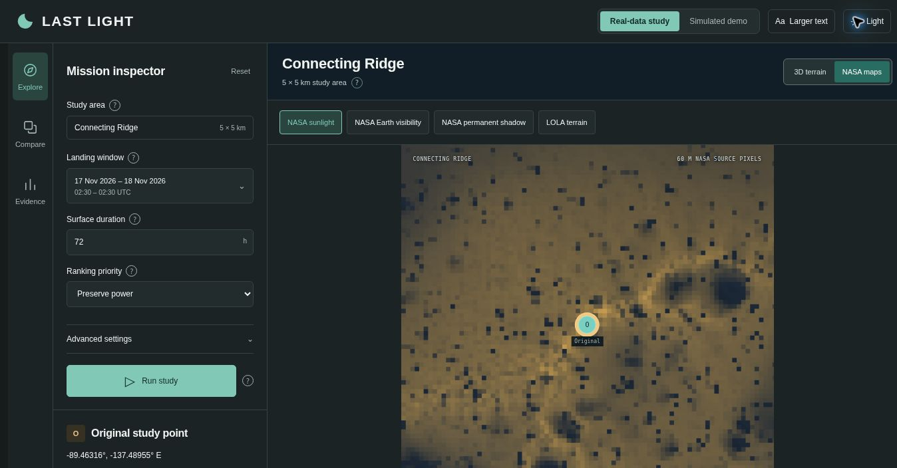

# Last Light — Lunar Landing Scenario Navigator

Built for the **2026 NASA Space Apps Challenge**, Last Light asks a practical question: if a lunar landing time changes, which nearby sites would keep the lander powered, and for how long would Earth be visible? The web app compares an original plan with alternatives inside a **5 × 5 km** area of Connecting Ridge near the Moon’s south pole. Students and early-stage mission analysts can inspect the assumptions and trade-offs behind each ranking.

**[Open the live app](https://last-light.style.dev/)** · **[View a completed study immediately](https://last-light.style.dev/presentation-backup.html)** · [Run locally](#run-locally)



## Try a study

1. Open **Real-data study**. In **Mission inspector**, keep **Preserve power** and select **Run study**. The default landing window starts at the current UTC time rounded up to a 15-minute boundary and extends 24 hours. Each candidate is evaluated for **72 hours on the surface**. A first calculation can take a few minutes.
2. In **Compare**, look for up to three passing alternatives (R1–R3). Select an alternative and compare it with **Original**. Scrub **Elapsed time** on the mission timeline to see when the Sun or Earth clears the local terrain and how much battery charge remains. A search can return zero alternatives. The saved report above shows a completed example without running the engine.
3. Change the question. Under **Advanced settings → Alternatives & priority**, choose **Same site, different time** to isolate the effect of arrival time. To compare sites on a common date, choose **Different site, same time** and include the original landing time in the window. Use **NASA maps** to pick a point, or enter coordinates under **Location & landing time** and select **Locate entered coordinates**.
4. After a run, **Download study JSON** exports results, inputs and study metadata including source checksums. Under **Evidence behind the estimates**, select **Run / show reference checks** to compare computed directions with saved JPL Horizons reference outputs.

**Simulated demo** runs a separate browser model with three fictional sites and illustrative ground-pressure assumptions. Its sample interval runs from 15 November to 1 December 2026 UTC in 15-minute steps, and the full mission must fit inside it. [Simulated demo guide](SIMULATED_DEMO.md)

## What goes into a ranking?

| Setting | Real-study behavior |
| --- | --- |
| Dates and duration | Enter whole-minute UTC landing times. The alternative arrival window can span at most 72 hours. Surface duration is 1–168 hours. The full original mission and the latest allowed mission must fit within the loaded kernel coverage, restricted to 2000–2049. |
| Geographic search | For site changes, screen a 250 m grid within the footprint and relocation radius. Analyze up to eight passing locations at least 500 m apart in addition to the original. For time changes, sample every six hours from the earliest arrival and include the latest endpoint. |
| Filtering and ranking | Apply the selected terrain, visibility and power limits before ranking. **Preserve power** favors the highest minimum battery charge in the lower sensitivity case, then generated energy in that case. Other priorities favor schedule, Earth visibility or minimum relocation. A time-only search can return several times at one location. |
| Interface and API defaults | The interface starts with panel-based power, ideal Sun tracking, a 20% minimum for each archived visibility frequency and **Preserve power**. Direct API clients should send these settings explicitly to reproduce the UI. Omitted API fields default to constant generation, zero frequency minima and schedule priority. |

Rankings cover the scenarios the engine evaluated. A candidate with good illumination can still have long gaps in Earth visibility. Requiring known ground support yields zero qualifying options because soil strength, rock clearance and sinkage are unassessed. Flight reachability, descent safety, thermal behavior, eclipses and radio-link performance also remain outside the model.

## Data, calculations and evidence

| Source | How Last Light uses it |
| --- | --- |
| [NASA high-resolution LOLA topography](https://pgda.gsfc.nasa.gov/products/78) and [PDS gridded terrain](https://pds-geosciences.wustl.edu/missions/lro/lola.htm) | Regional elevation, slope and uncertainty products support local terrain screening. Surrounding and global elevations extend the horizon calculation. The interactive 3D view samples the 5 m elevation grid every 50 m at true vertical scale, with illustrative shading. |
| [NASA Lunar Polar Illumination](https://pgda.gsfc.nasa.gov/products/69) | Archived 60 m sunlight, Earth-visibility and permanent-shadow maps screen candidate sites. The frequencies summarize an 18.6-year modeled cycle. The mission timeline calculates visibility for the selected dates separately. |
| [NASA/JPL NAIF SPICE](https://naif.jpl.nasa.gov/naif/) | DE421 geometry places the Sun and Earth relative to an elevated observer and the local terrain horizon. Panel area, pointing, efficiency, losses, visible solar-disc fraction and electrical load determine estimated battery charge. Earth visibility can use the disc centre or any visible portion. |
| [NASA/JPL Horizons](https://ssd.jpl.nasa.gov/horizons/) | Two committed fixtures provide hourly azimuth and elevation at one observer for 25 times per body. The reference check measures angular differences against a 0.0001° tolerance. Its scope is direction accuracy at those samples. |

The app’s NASA Artemis I and Canadian Space Agency Artemis II links explain launch and arrival timing. Users supply a landing window from their own mission plan. [Timing references in the interface](src/NasaScreening.jsx)

The [committed provenance record](provenance/sources.json) lists 22 reference assets, URLs, sizes, retrieval dates and SHA-256 hashes. On a fresh install, the downloader writes a **local** `data/sources.json` from the bytes it receives. Startup hashes the required files against that local manifest. Subsequent downloads reuse matching files. For an independent comparison against the recorded project inputs, compare the two manifests by asset name and hash.

[Mathematics and assumptions](MATHEMATICS.md) · [Validation and limitations](VALIDATION.md) · [Mission Studio interface](MISSION_STUDIO.md)

## Assistant and accessibility

Open **Ask Last Light** for site help or choose **Plan a real study**. Supply a date with a year, surface duration and priority, review the proposed settings, then choose **Calculate real options**. The planner sends the request to the same numerical engine as the form. **Autofill & run** evaluates a returned candidate at its exact location and time.

Local guide replies, supported language parsing and structured planning work without a model key. Optional OpenRouter interpretation requires server-side `CHAT_ENABLED=true` and `OPENROUTER_API_KEY`. `CHAT_MODEL` overrides the configured model. If the provider is unavailable, the app retains the guide and structured controls. Python reads the process environment; a copied `.env` file alone does not activate the provider. Keep keys on the server. [Assistant setup and behavior](docs/SITE_ASSISTANT.md) · [Example settings](.env.example)

The workspace includes keyboard navigation, contextual help, larger controls, light and dark themes, and a text/table alternative to the terrain and timeline. On supported browsers, **Mic** fills an editable draft before sending. Dictation requires permission and may use the browser’s recognition provider.

## Run locally

Use Python 3.12 (the Windows setup accepts 3.12+) and Git. Allow about **525 MB** for the recorded source files, plus space for the environment and generated caches. Initial setup needs internet access. Later real studies use the local rasters and kernels. The repository includes a built frontend in `dist/`, so the local launcher runs without Node.js.

**Windows PowerShell**

```powershell
git clone https://github.com/Mxxde-e/NASA-SpaceApps-Last-Light.git
cd NASA-SpaceApps-Last-Light
.\Setup-Last-Light.ps1
.\Start-Last-Light.cmd
```

If the default Python is unsuitable, pass its path with `-Python` to the setup script. The launcher opens the browser when the study service is ready.

**macOS or Linux**

```sh
git clone https://github.com/Mxxde-e/NASA-SpaceApps-Last-Light.git
cd NASA-SpaceApps-Last-Light
python3.12 -m venv .venv
.venv/bin/python -m pip install -r backend/requirements.lock.txt
.venv/bin/python -m backend.acquire
.venv/bin/python -m backend.server
```

Open **http://127.0.0.1:8000** and keep the server terminal open. If setup is interrupted, rerun the acquisition step. If the interface is waiting for the engine while data loads, select **Retry connection**. To view an example offline without installing the app, download [the saved HTML report](docs/presentation-backup.html) and open it in a browser.

## Develop and test

The frontend uses React, Three.js and Vite. For frontend development, use Node.js 24 and the repository’s declared **pnpm 11.25.0** with its committed lockfile:

```sh
pnpm install --frozen-lockfile
pnpm test
pnpm run build
```

To edit interactively, start the Python server as above and run `pnpm run dev` in a second terminal. Vite proxies `/api` to port 8000. A build copies the public preview image and the saved report into `dist/`.

- **Frontend unit tests** exercise the simulated model, study client and terrain geometry without NASA downloads or a browser. The CI npm alternative is `npm install --package-lock=false`, `npm test` and `npm run build`.
- **Python tests** run with `.venv/bin/python -m pytest` on macOS/Linux or `.\.venv\Scripts\python.exe -m pytest` in PowerShell. On a clean checkout without a local source manifest, the data integration tests skip. Complete acquisition first to run terrain, SPICE, Horizons and real-search checks. The remaining tests cover analytical behavior, ranking and assistant logic with offline or mocked provider paths.
- **Browser checks** use Playwright, Chromium and a local assistant test server. The [CI recipe](.github/workflows/site-assistant.yml) installs the test runner and browser separately and runs with AI disabled. Its triggers are manual dispatch and pushes to `feature/site-assistant`. A push to `main` alone does not trigger this workflow.

## Hosting and deployment

The public app runs on a Freestyle Linux VM. HTTPS traffic reaches nginx on port 8080, which proxies to a single FastAPI/Uvicorn worker on loopback port 8000. FastAPI serves both the frontend and the API. systemd manages the service and can load model settings from `/etc/last-light-chat.env`. GitHub merges require a separate VM update to go live. [Freestyle deployment guide](deploy/FREESTYLE.md)

The backend accepts one numerical search at a time. Clients submit to `POST /api/search` and poll `GET /api/jobs/{id}`. An overlapping search receives HTTP 429. Job state lives in memory, while completed studies are cached on disk by request, algorithm version and source hashes. The hosted app and hosted report depend on VM availability, compute and storage.

The [Dockerfile](backend/Dockerfile) provides an alternative to the VM service. Use the repository root as its build context, mount prepared data at `/app/data`, and allow writes for generated caches.

## License and development credits

The project code is available under the [MIT License](LICENSE). The data table above identifies the external sources. ChatGPT/Codex and image-generation tools assisted with development, debugging, UI concept exploration and documentation. Lovable assisted with presentation design. The team is responsible for the implementation, assumptions and interpretation.
